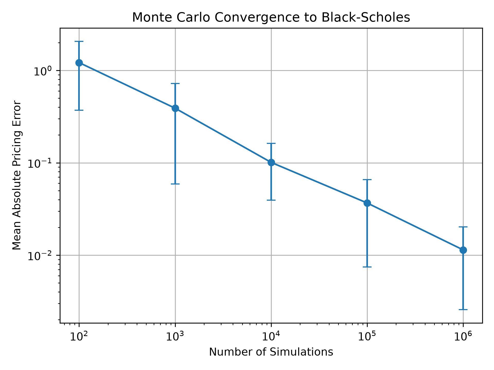
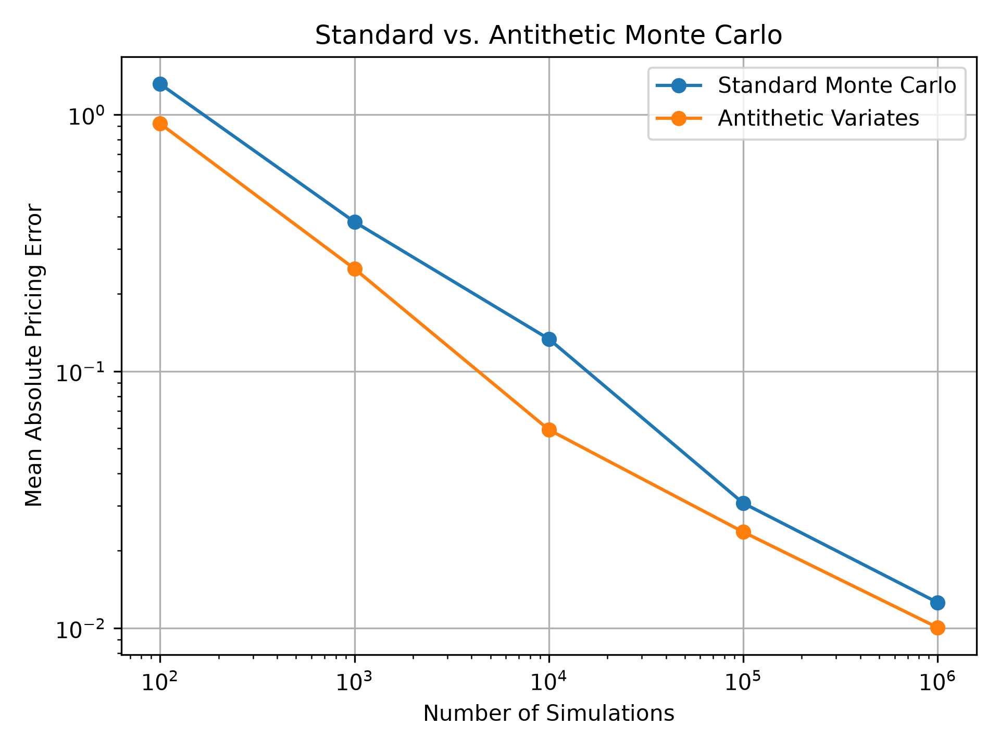

# Monte Carlo Option Pricing

A Python project exploring Monte Carlo methods for pricing European call options and comparing the numerical estimates with the Black-Scholes analytical solution.

## Overview

The goal of this project was to understand how Monte Carlo option pricing behaves in practice rather than simply implementing the pricing formula.

I simulated terminal stock prices under geometric Brownian motion, calculated European call-option payoffs, and discounted the expected payoff to obtain a Monte Carlo price estimate. I then compared those estimates against the Black-Scholes analytical price.

I also investigated how pricing error changes as the number of simulations increases and tested antithetic variates as a variance-reduction technique.

## Methods

For a stock following geometric Brownian motion, the terminal price is simulated as

S(T) = S(0) * exp((r - 0.5 * sigma^2)T + sigma * sqrt(T) * Z)

where Z is a standard normal random variable.

The European call payoff is

max(S(T) - K, 0)

and the Monte Carlo estimate is the discounted average payoff across the simulated outcomes.

The Black-Scholes formula is used as an analytical benchmark.

## Convergence Experiment

I tested simulation sizes ranging from 100 to 1,000,000 paths.

For each simulation size, I ran 30 independent trials and measured the absolute difference between the Monte Carlo estimate and the Black-Scholes price.

The results show that pricing error generally decreases as the number of simulations increases.



## Variance Reduction

I also implemented antithetic variates. For every randomly generated shock Z, the method also uses -Z.

This pairs positive and negative shocks and can reduce sampling noise.

Across the simulation sizes tested, the antithetic estimator produced lower mean absolute pricing error than standard Monte Carlo.



## Testing

The project includes automated tests for:

- European call payoff calculations
- positivity of simulated stock prices
- reproducibility using random seeds
- the Black-Scholes analytical value
- agreement between Monte Carlo estimates and Black-Scholes
- antithetic sampling behavior

Run the test suite with:

```bash
python -m pytest